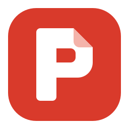
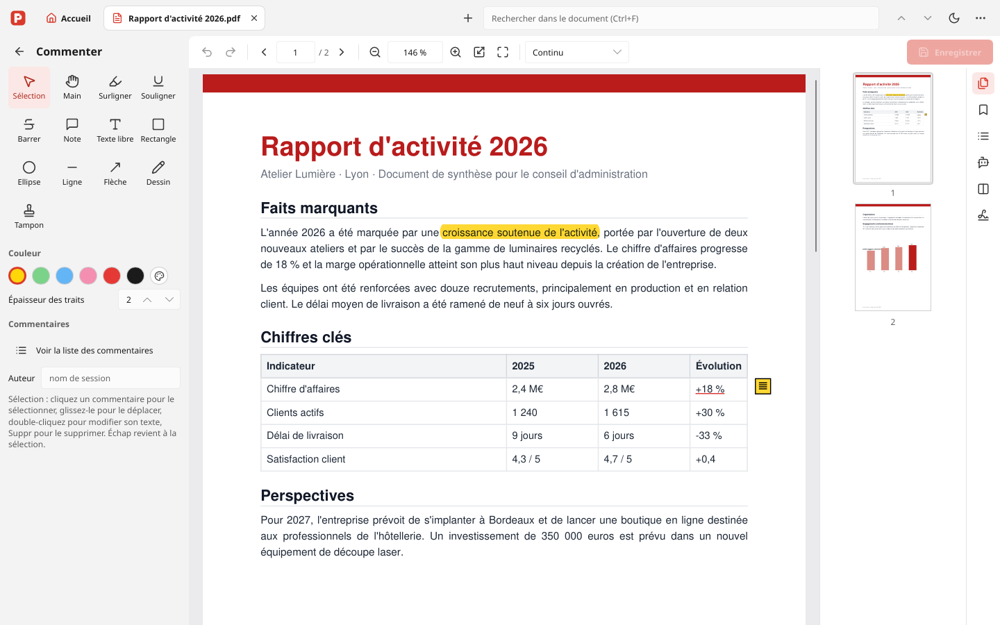
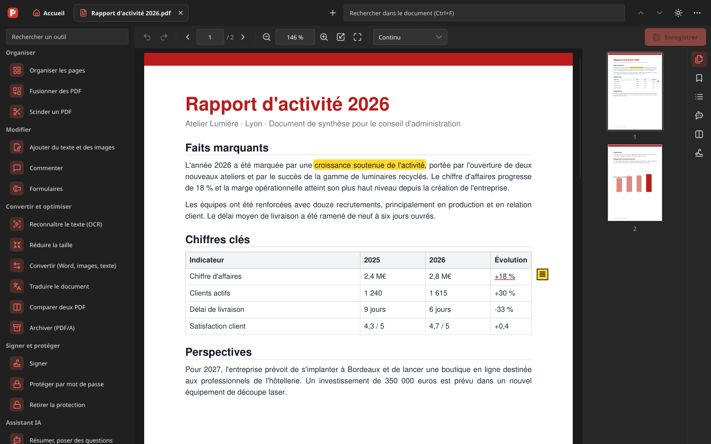
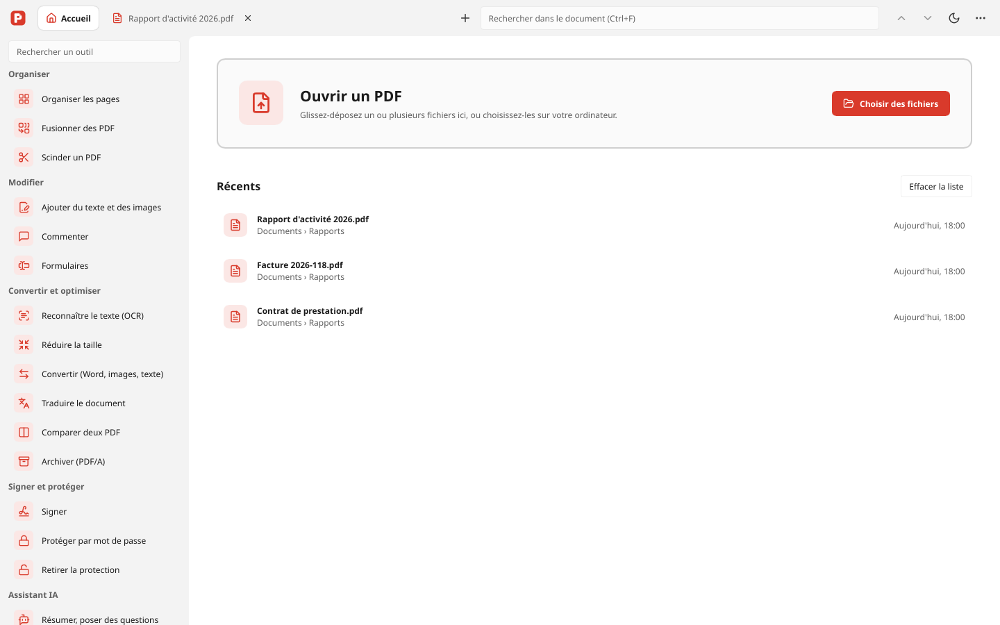
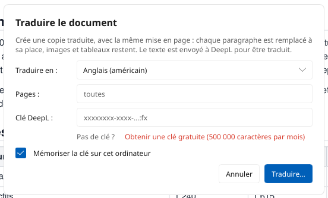

<div align="center">



# PDFManager

**A free, offline PDF editor for Windows, written in Rust.**<br>
Edit, annotate, sign, OCR, translate and compress PDFs: no account, no watermark, no subscription.

[](https://github.com/alexandreromanini/PDFManager-rs/releases/latest)
[](https://github.com/alexandreromanini/PDFManager-rs/actions/workflows/build-windows.yml)
[](#download)
[](docs/DEVELOPMENT.md)
[](LICENSE)

[**Download for Windows**](https://github.com/alexandreromanini/PDFManager-rs/releases/latest) ·
[Features](#features) ·
[Screenshots](#screenshots) ·
[All features](docs/FEATURES.md) ·
[Français](README.fr.md)



</div>

## Why PDFManager?

- **Everything a PDF editor should do, in one app**: the everyday features of Acrobat Pro
  (editing, comments, forms, signatures, OCR, conversions), free and open source.
- **Light and fast**: a 16 MB installer, instant start, built on [MuPDF](https://mupdf.com),
  the engine behind many PDF readers.
- **Private by design**: your documents are processed on your computer. Nothing is uploaded,
  except the text you choose to translate with DeepL.
- **Modern Windows 11 look**, light and dark themes, tabs, drag and drop, keyboard shortcuts.
- **Safe editing**: every change can be undone, files are saved atomically, signed documents
  are saved incrementally so that their signatures stay valid.

> The interface is in French. An English interface is not available yet.

## Features

| | |
|---|---|
| **View and organize** | Tabs, thumbnails, bookmarks, search, continuous, single or two-page view, presentation mode. Reorder, rotate, delete, extract, crop and insert pages; merge and split PDFs. |
| **Edit** | Edit existing text in place (keeps the original font when possible), add text, images and links, move and resize images, headers, footers, page numbers and watermarks. True redaction that really removes the content. |
| **Comment** | Highlight, underline, strike out, sticky notes, free text, shapes, freehand drawing and stamps, with a list of all comments. |
| **Forms** | Fill in forms, and create text fields, checkboxes, lists and signature fields. |
| **Sign and protect** | Handwritten signature, digital signatures (PAdES, with RFC 3161 timestamp) and signature verification; AES-256 password protection and permissions; printing. |
| **Convert and optimize** | OCR (French and English, built in, multi-core), file size reduction, PDF to Word (with tables), images or text, images and Office documents to PDF, PDF/A archiving, comparison of two PDFs. |
| **Translate** | Translate a whole document with DeepL while keeping its layout: each paragraph and table cell is rewritten in place. 28 languages. |
| **AI assistant** | Summarize a document and ask questions about it, with a small model that runs **offline** on your computer (optional 2.5 GB download). |

Every feature, with its known limits, is described in [docs/FEATURES.md](docs/FEATURES.md) (French).

## Screenshots

<table>
  <tr>
    <td></td>
    <td></td>
  </tr>
  <tr>
    <td align="center">Dark theme</td>
    <td align="center">Home screen and full tools catalog</td>
  </tr>
</table>

<p align="center"><br>Translating a document with DeepL</p>

## Download

1. Download **`PDFManager-rs-x.y.z-setup.exe`** from the
   [latest release](https://github.com/alexandreromanini/PDFManager-rs/releases/latest).
2. Run it. Windows may show *“Windows protected your PC”* because the installer is not
   code-signed: click **More info**, then **Run anyway**.
3. PDFManager checks for new versions and updates itself in one click.

Requirements: Windows 10 or 11, 64-bit. It installs as *PDFManager (Rust)* and can live next to
the Python edition. Optional: [Ghostscript](https://ghostscript.com/releases/gsdnld.html) for
PDF/A, [LibreOffice](https://www.libreoffice.org/download/download-libreoffice/) to convert Office
documents.

### Two editions

PDFManager exists in two editions with the same features and the same look:

| | PDFManager-rs (this repository) | [PDFManager](https://github.com/alexandreromanini/PDFManager) |
|---|---|---|
| Written in | Rust, Slint, MuPDF | Python 3.12, PySide6 (Qt), PyMuPDF |
| Installer | ~16 MB | ~100 MB |
| Best for | Everyday use: faster start, smaller | Hacking on the code in Python |

The detailed comparison is in [docs/COMPARAISON.md](docs/COMPARAISON.md) (French).

## Privacy

PDFManager works offline. It only goes online to:

- check for updates on GitHub;
- translate, when you use **Traduire le document** (the text is sent to DeepL);
- download the AI model, once, if you choose to enable the assistant.

## Build from source

```bash
cargo run --release -- document.pdf      # run
cargo test --release                     # unit tests
cargo build --release --features capture && python tests/parcours.py   # end-to-end scenarios
```

The Windows installer is built by GitHub Actions on every tag. See
[docs/DEVELOPMENT.md](docs/DEVELOPMENT.md) (French) for the setup and the project layout.

## Contributing

Bug reports, ideas and pull requests are welcome, in English or French. Please read
[CONTRIBUTING.md](CONTRIBUTING.md) first. To report a security issue, see [SECURITY.md](SECURITY.md).

## License

PDFManager is free software, released under the [GNU AGPL v3.0 or later](LICENSE).

Built with [MuPDF](https://mupdf.com) (through the [mupdf](https://crates.io/crates/mupdf) crate),
[Slint](https://slint.dev), [Tesseract](https://github.com/tesseract-ocr/tesseract),
[llama.cpp](https://github.com/ggml-org/llama.cpp) and [Lucide](https://lucide.dev) icons.
